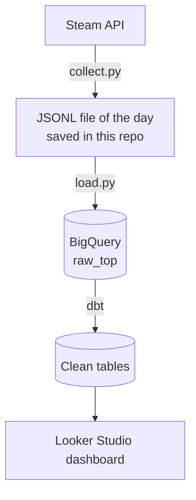

# Steam Market Data Pipeline

Every day, this project collects the 100 most played games on Steam, stores them in BigQuery, cleans them with dbt and shows them in a Looker Studio dashboard.


## How it works



A GitHub Actions workflow runs these steps every morning:

1. `collect.py` gets the top 100 from the Steam API, then the store page of each game (name, price, discount, genres). It saves one file per day in `data/`.
2. The new file is committed to the repo, so the full history is kept in GitHub.
3. `load.py` sends all the files of `data/` to BigQuery and replaces the `raw_top` table.
4. dbt builds the clean tables and runs the data tests.
5. The Looker Studio dashboard reads the clean tables.

## Data model

| Table | Content |
|---|---|
| `raw_top` | All collected days, as they come from the files |
| `stg_top` | Same data with clean types, price set to 0 for free games |
| `jeux_du_jour` | Top 100 of the last day, with the rank change since last week |
| `evolution_jeux` | Each game day by day, with the peak players of the previous day |
| `genres` | One row per genre: number of games, total players, average price |

dbt tests check that ranks and game ids are never empty and that a game appears only once per day.

## Choices

- **Full reload every day.** `raw_top` is rebuilt from all the files at each run. It keeps the code simple and the history is never lost, because it lives in the repo.
- **Free BigQuery sandbox.** The Google Cloud project has no billing account, so it costs nothing.
- **Service account with minimal rights.** GitHub connects to BigQuery with an account that can only edit tables and run jobs. Its key is stored in GitHub secrets.

## Tech stack

Python · Steam API · BigQuery · dbt · Looker Studio · GitHub Actions

## Run it yourself

```bash
pip install -r requirements.txt
python collect.py
python load.py
cd steam_dbt
dbt build --profiles-dir .
```

You need a Google Cloud project with a `steam` dataset, and to be logged in with `gcloud auth application-default login`. Change the project id in `load.py` and `steam_dbt/profiles.yml`.
